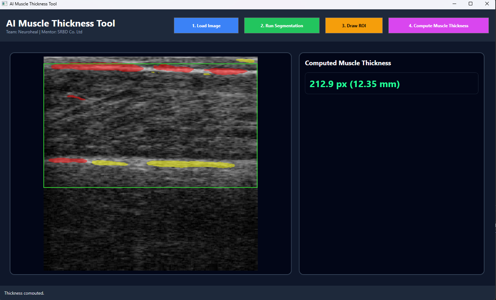

# AI-Based Muscle Thickness Measurement from Ultrasound

Automatic muscle thickness measurement from B-mode ultrasound images. A U-Net segments the superficial and deep aponeuroses, and the thickness is computed as the distance between the two boundaries. The trained model is exported to ONNX and runs fully offline inside a C# WPF desktop application.

Industry-mentored project by Team NeuroHeal, mentored by Samsung R&D Institute Bangladesh (SRBD), 2025.



## Results

Evaluated on a held-out test split of 51 images (FALLMUD, RyanCunningham subset, 80/10/10 split, seed 1337).

| Metric | Value |
|---|---|
| Dice, superficial aponeurosis | 0.830 |
| Dice, deep aponeurosis | 0.815 |
| **Mean Dice** | **0.823** |
| Thickness error, mean absolute (pixels) | 2.96 |
| Thickness error, median (pixels) | 2.75 |
| Test images within 5 px of ground truth | 82.4% |
| Inference time (GPU, 640×640) | 10.9 ms / image |

Ground-truth thickness is measured from the annotated masks with the same algorithm, so the error reflects segmentation quality only.

## Pipeline

```
Ultrasound image -> resize 640x640 -> U-Net (ONNX Runtime) -> SUP / DEEP mask
  -> per-column distance between boundaries -> median -> thickness (px, mm)
```

- **Model:** U-Net with a MobileNetV3-Large encoder (`segmentation_models_pytorch`), 3 classes: background, superficial, deep aponeurosis
- **Training:** weighted cross-entropy plus a Laplacian boundary loss, AdamW (lr 2e-4), 40 epochs, mixed precision
- **Preprocessing / augmentation:** CLAHE, sharpening, random brightness/contrast, Gaussian blur and noise
- **Measurement:** for each column in the ROI, take the median row of each boundary, compute the distance, then the median over columns to suppress outliers
- **Deployment:** PyTorch -> ONNX (opset 18) -> ONNX Runtime in C# / .NET WPF, no internet or server needed

## Repository structure

```
models/      apo_model.onnx + apo_model.onnx.data (trained weights)
training/    AI_Muscle_Segmentation_Model.ipynb (data prep, training, evaluation, export)
inference/   predict_thickness.py (standalone Python inference)
app/         C# WPF desktop application source
samples/     example ultrasound images
docs/        screenshot and demo video (docs/demo.mp4)
```

## Quick start

### Python

```bash
pip install -r requirements.txt
python inference/predict_thickness.py samples/sample_01.jpg --mm-per-px 0.058
```

Writes `result.json` (thickness in px and mm) and `seg_result.png` (mask).

### Desktop app (Windows)

1. Open `app/MuscleThicknessApp.slnx` in Visual Studio 2022+ (.NET 10 SDK).
2. Build and run. The model files in `models/` are copied next to the executable automatically.
3. **Load Image** -> **Run Segmentation** -> **Draw ROI** -> **Compute Muscle Thickness**.

## Dataset

Trained on **FALLMUD** (Functional Assessment of Lower Limb Muscles in Ultrasound Database), a public dataset of lower-limb ultrasound images with annotated aponeurosis boundaries. The dataset is not included in this repository; download it from its original source and place the zip at the path set in the first notebook cell.

## Limitations

- Region of interest is drawn manually.
- Millimeter conversion uses a fixed pixel spacing (0.058 mm/px); real use needs per-probe calibration.
- Trained and tested on one FALLMUD subset only; no cross-device or clinical validation.
- Measurement tool only. It does not diagnose injuries or tears.

## Team

Hasan MD Roman, Tanvir Ahamed, Jakaria Hossain Khan, Al Roman

My role (Tanvir Ahamed): trained the U-Net segmentation model, exported it to ONNX, and built the C# WPF desktop application.
